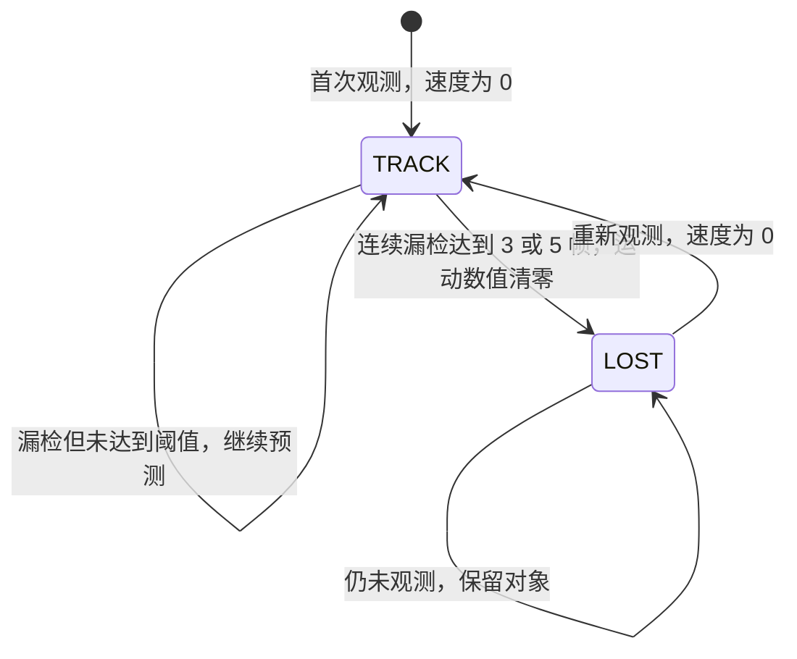

# 从题目到代码：初学者逐步讲解

建议先运行一次程序，再按下面顺序读代码。每一节都说明：题目提出什么要求、为什么需要这些数据、对应代码在哪里。

## 第一步：把项目下载下来，建立开发分支

从零开始时使用：

```bash
git clone https://github.com/Rosmarinus-Young/vision-tracker.git
cd vision-tracker
git switch -c develop
```

- `git clone`：下载文件和已有的提交历史。
- `cd`：进入项目文件夹。
- `git switch -c develop`：新建并切换到 `develop` 分支。此次原仓库只有 `main`，所以需要 `-c` 创建。

本次已经执行这些操作。拿到完成版后，`develop` 已存在，需要切换时用 `git switch develop`。

原 README 是题目，最终要被报告覆盖，所以先把它保存为 [assignment.md](assignment.md)。这一步保留验收依据，避免写完代码后找不到原要求。

## 第二步：把输入和输出读懂

先打开 [data_types.hpp](../include/data_types.hpp)。它规定了四种结构体：

| 类型 | 可以怎样理解 |
| --- | --- |
| `Observation` | 这一次检测到一个目标的记录 |
| `InputFrame` | 某个时刻检测到的全部目标 |
| `TargetSnapshot` | 一个目标处理后的状态副本 |
| `Result` | 本帧是否接受、所有目标快照和统计数量 |

`InputFrame.observations` 是本帧实际看见的目标。管理器保存的是历史上创建过的所有目标，所以输出中会包含本帧没看见的目标。

`frame_id` 表示帧编号；`id` 表示目标编号。它们是不同概念：一帧可以同时包含编号为 1、2、3 的多个目标。

`enum class` 把类型或状态限制为一组有名称的值，例如 `rm::TargetStatus::TRACK`，比在程序各处写数字 `1` 更容易理解。

这些是老师提供的数据接口，整个实现保持它们不变。

## 第三步：从“共同点”和“差异”拆出四个类

普通装甲和旋转装甲都有编号、位置、速度、预测位置、状态、漏检次数。因此把公共数据与处理过程放在 [TrackingBase](../include/TrackingBase/TrackingBase.hpp) 中。

两类目标的差异只有丢失阈值和角度处理规则，所以派生类只需要提供这些差异：

| 函数 | `ArmorTarget` | `SpinningTarget` |
| --- | --- | --- |
| `lostThreshold()` | 返回 3 | 返回 5 |
| `tracksAngle()` | 返回 false | 返回 true |

基类中的 `= 0` 表示纯虚函数：这里只约定“需要提供这个规则”，由派生类实现。这样的基类叫抽象类，不能直接创建 `TrackingBase` 对象。

`override` 表示派生类正在覆写基类虚函数；如果函数名或参数写错，编译器能帮助发现。

管理器需要同时保存两类对象，于是使用：

```cpp
std::vector<std::unique_ptr<TrackingBase>> targets_;
```

先分三层理解：

1. `vector` 是可以变长的数组，新目标出现时用 `push_back()` 加进去。
2. `TrackingBase` 指针能指向继承它的两种装甲对象。
3. `unique_ptr` 负责对象寿命，管理器销毁时自动释放内存。

管理器调用 `target->observe()` 时进入基类公共流程。公共流程内部调用虚函数 `tracksAngle()` 时，会根据对象实际类型得到不同结果。这就是这里使用的多态。

如果直接存 `vector<TrackingBase>`，既无法创建抽象基类对象，也无法保留派生类的多态行为；存基类指针就可以统一管理。

`virtual ~TrackingBase() = default;` 是虚析构函数。它让通过基类指针销毁对象时，也能正确执行派生类的析构过程。

## 第四步：先决定哪些数据必须长期保存

在 [TrackingBase.cpp](../src/TrackingBase/TrackingBase.cpp) 中，目标创建后会记住：

- `snapshot_`：当前对外状态，含位置、速度、预测、状态等。
- `last_observation_`：上一次真正检测到的坐标和角度。
- `last_observation_timestamp_ns_`：上一次真正检测到它的时刻。

为什么要保存上一次观测？因为速度需要两次观测之间的位移和时间差。

为什么要把真实观测和当前快照分开？因为漏检时旋转装甲的 `angle` 会按角速度推进。这个推算角度不能替代上次真实检测到的角度。

管理器还需要保存 `last_frame_id_` 和 `last_timestamp_ns_`，用于拒绝重复、回退的输入，并计算帧间隔。

`has_successful_frame_` 用来区分“尚未处理过任何有效帧”和“已经处理了第 0 帧”。这样时间戳为 0 的合法首帧不会被误拒绝。

数据成员写在 `private` 下，外部通过函数访问；这就是封装。`getSnapshot()` 返回副本，因此外部修改这个副本不会破坏目标内部状态。

## 第五步：用最基本的路程公式计算速度和预测

公式来自：

```text
速度 = 位移 / 时间
预测位置 = 当前位置 + 速度 × 时间
```

这里有两种时间：

| 变量 | 含义 | 用途 |
| --- | --- | --- |
| `dt` | 本帧与上一个成功处理帧之间的间隔 | 向前预测 |
| `dt_obs` | 本次与上次看见同一个目标之间的间隔 | 估计速度 |

时间戳以纳秒保存，一秒等于十亿纳秒：

```cpp
double dt_obs = (timestamp_ns - last_observation_timestamp_ns_) / 1e9;
```

`1e9` 是浮点常量，结果可以保留 `0.1`、`0.3` 这样的小数。

用题目第 6 帧举例：

```text
目标 1 上一次在第 3 帧被看见：x = 4，时间 0.3 秒
这次在第 6 帧被看见：      x = 5，时间 0.6 秒

观测间隔 dt_obs = 0.6 - 0.3 = 0.3 秒
速度 vx = (5 - 4) / 0.3 ≈ 3.3333 米/秒

上一个成功帧是第 5 帧，时间 0.5 秒
本帧间隔 dt = 0.6 - 0.5 = 0.1 秒
下一帧预测 x = 5 + 3.3333 × 0.1 ≈ 5.3333 米
```

漏检期间不改写观测坐标 `x/y`，只继续推进预测：

```text
第 6 帧预测 x ≈ 5.3333
第 7 帧没有看到它：预测 x ≈ 5.3333 + 0.3333 = 5.6667
第 8 帧仍没看到它：预测 x ≈ 5.6667 + 0.3333 = 6.0000
```

角速度也用同样的差分公式，单位是度/秒；题目没有要求角度归一化，因此直接使用观测角度差。

旋转目标第 1 帧的角度是 `0.2`，角速度是 `2`。第 2 帧没有观测到它，时间间隔 `0.1` 秒：

```text
当前角度 = 0.2 + 2 × 0.1 = 0.4
预测角度 = 0.4 + 2 × 0.1 = 0.6
```

以后重新观测时，速度计算仍以保存的真实观测为依据。

## 第六步：把“跟踪”和“丢失”写成清楚的状态变化



在 `miss()` 中：

1. 已经 `LOST` 就直接返回。
2. 否则 `missed_count` 加 1。
3. 达到阈值，改成 `LOST` 并调用 `clearMotion()`。
4. 未达到阈值，继续预测。

`clearMotion()` 清零全部九个运动字段，保留编号、类型和漏检次数。

在 `observe()` 中，如果之前是 `LOST`，首先将速度置 0；再把当前位置更新为观测位置。速度为 0 时，公式自然得到“预测位置等于观测位置”。

丢失后保留对象，才能认出后面重新出现的编号。目标恢复时无需重新创建对象，类型限制也仍然有效。

## 第七步：先检查整帧，再修改目标

打开 [TargetManager.cpp](../src/TargetManager/TargetManager.cpp)。一帧处理分为两段：

```cpp
if (!isValidFrame(frame))
{
    return makeResult(frame.frame_id, false);
}
// 走到这里以后，才能修改目标和成功帧记录。
```

这是为了满足“整帧拒绝”。例如一帧里有：

```text
第一条：合法更新目标 1
第二条：合法创建目标 77
第三条：目标编号是 -1，非法
```

如果边检查边更新，处理到第三条才发现错误时，前两条已经影响了状态。先完整检查一遍，就可以直接拒绝而无需撤销任何修改。

校验项目：

1. 帧号严格大于上一成功帧。
2. 时间戳严格大于上一成功帧。
3. 目标编号不能是负数；负坐标是允许的。
4. 同一帧编号不能重复，用两层 `for` 比较。
5. 已经创建过的目标不能改变类型。

`findTargetIndex()` 逐个比较目标编号，找到返回数组下标，找不到返回 `-1`。这里目标数量少，使用普通循环便于理解；大量目标时可以进一步考虑更快的查找容器。

通过校验后先处理所有观测，再找出本帧没有出现的目标调用 `miss()`，最后更新成功帧记录并生成结果。

注意：漏检次数按“处理了几帧有效输入”增加，帧号从 1 跳到 20 也只处理了一帧。拒绝的输入不会增加漏检次数。

## 第八步：把结果组织好，再接入入口程序

`makeResult()` 每次从 0 开始统计：

```cpp
rm::Result result{};
```

花括号让几个整数计数从 0 开始，避免使用没有初始化的局部变量。

随后遍历全部目标：复制快照，按状态增加一个计数，再按类型增加一个计数。这样会有：

```text
tracking_target_count + lost_target_count == targets.size()
armor_target_count + spinning_target_count == targets.size()
```

`main.cpp` 的打印函数已由老师给出。因此只删除占位类并引入真实管理器头文件，保留入口和输出格式。

CMake 中把四个类的 `.cpp` 文件组成 `tracking` 库，让主程序和测试程序共用。这样测试使用的是同一份实现。

## 第九步：编译和测试，而不是只看“能不能运行”

```bash
cmake -S . -B build -DCMAKE_BUILD_TYPE=Debug
cmake --build build --parallel 2
./build/tracker
ctest --test-dir build --output-on-failure
```

第一条生成构建配置；第二条编译并链接；第三条处理老师提供的 28 帧；第四条执行补充的自动检查。

[tracker_tests.cpp](../tests/tracker_tests.cpp) 把检查分成四组：原始输入、拒绝时状态不变、不规则时间和恢复、首帧边界情况。

测试中的期望值是根据公式手算的。例如速度期望写成 `10.0 / 3`，比较时允许很小的浮点误差。非法帧的状态则必须与拒绝前完全相同。

这些测试还特意让一帧前几条合法、最后一条非法，防止“先更新后拒绝”的错误蒙混过关。

本次实测四组通过，完整主程序输出保存在 [test-output.txt](test-output.txt)。

## 第十步：报告、提交与验收

根目录 [README.md](../README.md) 已改为按模板填写的实现报告，姓名、学号和个人仓库地址留给本人填写。

提交分为功能、测试、文档三次，再合并到 `main`。每个 commit 表达一个明确目的，便于查看哪次改动影响了什么。

下载包的 Git 历史已经保留，无需重新 `git init`。创建个人远程仓库和推送的具体步骤见 [SUBMISSION.md](SUBMISSION.md)。

验收前可以对照代码讲清楚这些问题：

- 为什么普通和旋转装甲适合继承同一个基类？
- 第 6 帧为什么用 `0.3` 秒算速度，却用 `0.1` 秒预测？
- 为什么要单独保存真实观测角度？
- 为什么非法帧里合法的前几条也不能执行？
- `LOST` 后为什么保留对象，重新出现时为什么速度归零？
- `static constexpr`、`unique_ptr` 和虚析构函数各解决了什么问题？

把第 6 帧、第 12–13 帧和一帧非法输入手算一遍，再对照输出，就能把主要逻辑串起来。
